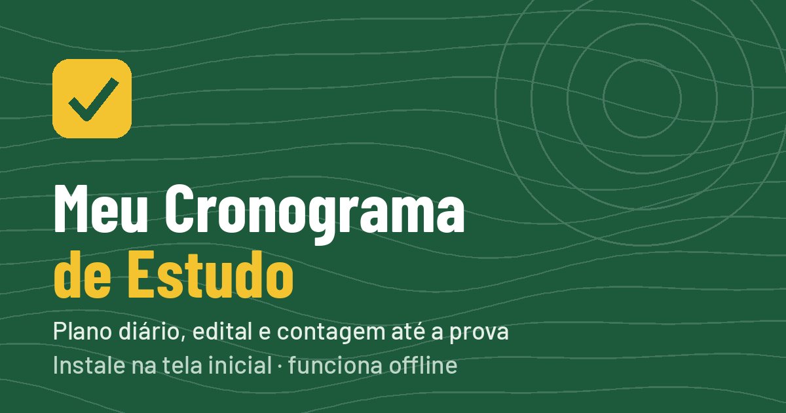
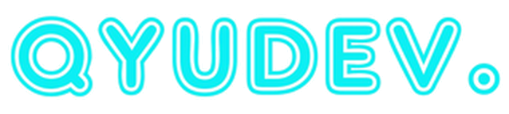

<div align="center">



# Meu Cronograma de Estudo

**O que estudar hoje, o edital na palma da mão e a contagem até a prova.**<br>
Um app de cronograma para concursos que se reorganiza sozinho no seu ritmo.

[](https://jacobbv.github.io/meu-cronograma-estudo/)


</div>

---

## ✨ O que ele faz

### 🗂️ Vitrine de concursos
Cronogramas prontos, montados a partir dos editais oficiais. É só escolher e começar.

| Concurso | Cargo | Banca | Edital-base |
|---|---|---|---|
| IBGE | Recenseador | Cesgranrio | 2026 |
| PCPE | Agente e Escrivão de Polícia | Cebraspe | 2026 |
| PMPE | Soldado | Instituto AOCP | 2026 |
| CBMPE | Soldado | Instituto AOCP | 2026 |
| Câmara de Guarabira | Auxiliar Administrativo | CPCon/UEPB | 2026 |
| IFPB | Professor Substituto (Informática) | COMPEC/IFPB | 2026 |
| PF | Agente e Escrivão | Cebraspe | 2025 |
| PRF | Policial Rodoviário Federal | Cebraspe | 2021 |

O selo de cada concurso muda sozinho pela data:

| Selo | Quando |
|---|---|
| 🟢 **Inscrições abertas** | curto prazo, enquanto dá para se inscrever |
| 🔵 **Pós-edital** | médio prazo, até o dia da prova |
| 🟤 **Pré-edital** | longo prazo, depois da prova; o app pergunta até quando você quer fechar o conteúdo (3 meses, 6 meses ou 1 ano) |

### 📡 Radar de concursos
Um robô gratuito (GitHub Actions) olha todo dia o PCI Concursos, o blog do Gran e o Estratégia e mostra na vitrine os concursos com inscrições abertas e as últimas notícias, com filtro por estado. Um toque em **Montar cronograma** já leva o nome e o link do concurso.

### 🤝 Comunidade
Montou um cronograma a partir do edital? Compartilhe na vitrine com o selo **Criado pela comunidade**. Vai só o conteúdo, nunca o seu progresso. Só quem criou pode atualizar ou tirar.

### 📄 Monte a partir do seu edital
Envie o **PDF do edital** ou **cole o conteúdo programático**. O app separa matérias e assuntos, pergunta o cargo quando há mais de um, tenta achar a data da prova e a banca, e mostra tudo para você conferir. A leitura acontece no próprio aparelho: o arquivo não é enviado para lugar nenhum.

### 📅 Um dia de cada vez
- **Hoje:** os assuntos do dia, separados em etapas (videoaula, leitura, questões).
- **Fila inteligente:** as matérias se intercalam; se você adianta ou atrasa, os próximos dias se ajeitam sozinhos, sem acumular culpa.
- **Ritmo por dia da semana:** quantos assuntos em cada dia, com a previsão de quando o conteúdo termina.
- **Reta final automática:** revisão por matéria (a mais fraca primeiro), simulado e véspera leve.
- **Pausas e feriados:** viagem ou feriado não quebram o plano.
- **Calendário** por semana ou por mês, com uma cor para cada matéria.

### 🔥 Motivação
- **Foguinho:** sequência de dias estudados, com recorde e chance de reacender.
- **Placar de questões:** percentual de acerto por matéria e o seu ponto fraco.
- **Avisos:** os prazos do edital aparecem quando estão chegando.

### 📊 Edital e prova
- Gráfico de andamento por matéria e o edital verticalizado para marcar.
- Data, horário, banca, distribuição das questões, datas importantes e o que levar no dia.
- **Seu curso:** escolha a plataforma (Gran, Estratégia, Aprova, Focus, Direção, AlfaCon, QConcursos, YouTube…) e o botão **Abrir aula** leva direto ao seu curso.

### ☁️ Conta e aparelhos
- Entre com **Google** ou **e-mail e senha** e continue de qualquer celular, tablet ou computador.
- Funciona **sem internet** e sincroniza quando a conexão volta.
- Prefere sem conta? Também dá: tudo fica salvo só no aparelho, com cópia de segurança.
- Tema claro, noite ou automático e seis cores para escolher.
- **Voltar deslizando** da borda da tela, como nos outros apps.
- **No computador**, um layout próprio: barra lateral, Hoje em duas colunas, semana como agenda e vitrine em grade. Celular e tablet ficam como estão.
- Botão para **compartilhar o app** com quem também está estudando.

---

## 📲 Como instalar

| iPhone / iPad | Android |
|---|---|
| Abra no **Safari** → Compartilhar → **Adicionar à Tela de Início** | Abra no **Chrome** → menu ⋮ → **Instalar app** |

Abra uma vez com internet: depois o app funciona offline.

## 🔒 Seus dados

- **Com conta:** cada pessoa tem um documento só seu no Cloud Firestore. As regras do banco só deixam você ler e gravar os seus próprios dados.
- **Sem conta:** tudo fica no próprio aparelho.
- **PDF do edital:** lido no aparelho, nunca enviado.
- **Comunidade:** só o que você decidir compartilhar fica público (seu primeiro nome, o concurso e o conteúdo). O progresso nunca vai junto.

---

<details>
<summary><b>🛠️ Para desenvolvedores</b></summary>

### Tecnologias
HTML, CSS e JavaScript puro, sem framework e sem build · PWA (manifest + service worker) · PDF.js · Firebase Authentication e Cloud Firestore no plano gratuito · GitHub Pages.

### Estrutura
```
index.html              # o app inteiro (HTML, CSS e JS)
vitrine.js              # concursos prontos da vitrine
firebase-config.js      # configuração pública do Firebase
sw.js                   # service worker (cache offline)
manifest.webmanifest    # nome, cores e ícones do app instalado
apostila.pdf            # apostila oficial do 12º Censo Agro (IBGE), sem alterações
vendor/                 # PDF.js 3.11.174
tools/parse.py          # leitor do conteúdo programático (mesmas regras do app)
tools/build_vitrine.py  # gera o vitrine.js a partir do texto dos editais
tools/robo.mjs          # robô do radar (node tools/robo.mjs --teste roda os testes)
radar.json              # gerado pelo robô todo dia
firestore.rules         # regras do banco (usuários e comunidade)
.github/workflows/      # agenda diária do robô
docs/                   # imagens do README
```

### Rodar localmente
```bash
python3 -m http.server 8000
# abra http://localhost:8000
```

### Configurar o Firebase
1. Crie um projeto no [console do Firebase](https://console.firebase.google.com) (plano Spark, sem cartão).
2. Em **Authentication**, ative **Google** e **E-mail/senha** e autorize o domínio do site.
3. Em **Firestore**, crie o banco e publique as regras do arquivo [`firestore.rules`](firestore.rules), trocando `EMAIL_DO_ADMIN` pelo e-mail de quem pode tirar modelos da comunidade.
4. Registre um app **Web** e cole o `firebaseConfig` em `firebase-config.js`. Essas chaves são públicas por natureza; quem protege os dados são as regras.

### Robô do radar
Roda sozinho todo dia às 06h17 (Fortaleza). Para rodar na hora: **Actions › Radar de concursos › Run workflow**. Ele só grava o `radar.json` quando há novidade.

### Atualizar a vitrine
```bash
pdftotext -layout edital.pdf editais/nome.txt   # editais do Diário Oficial em colunas: sem -layout
EDITAIS=editais/ python3 tools/build_vitrine.py
```

</details>

## 📜 Créditos

- **Fontes Barlow e Barlow Condensed:** Jeremy Tribby, via [Google Fonts](https://fonts.google.com/specimen/Barlow) · [SIL Open Font License 1.1](https://openfontlicense.org)
- **Firebase JS SDK 10.14.1:** [Google](https://firebase.google.com) · [Apache 2.0](https://github.com/firebase/firebase-js-sdk/blob/main/LICENSE)
- **PDF.js 3.11.174:** [Mozilla](https://mozilla.github.io/pdf.js/) · [Apache 2.0](https://www.apache.org/licenses/LICENSE-2.0)
- **Apostila do Censo Agro:** [IBGE](https://www.ibge.gov.br) (ENCE / CTA), distribuída sem alterações, como publicada pela [Fundação Cesgranrio](https://www.cesgranrio.org.br)
- **Vitrine:** montada a partir dos editais oficiais publicados por Cesgranrio, Cebraspe, Instituto AOCP, CPCon/UEPB e COMPEC/IFPB. Datas e conteúdos podem mudar: confira sempre o site da banca.
- Gran, Estratégia, Aprova, Focus, Direção, AlfaCon, QConcursos e YouTube são marcas dos seus donos. O app só abre o link do curso que você salvar e não tem relação com essas empresas, com as bancas ou com os órgãos.
- Ícones, ilustrações e imagens desenhados no próprio projeto.

## 🗒️ Versões

**Atual: v4.7.0** — fixar o concurso principal.<br>
Histórico completo no [CHANGELOG](CHANGELOG.md).

---

<div align="center">

Desenvolvido por<br>
<a href="https://jacobbv.github.io/"></a><br>
**Jacó** · [@JacobbV](https://github.com/JacobbV)

</div>
